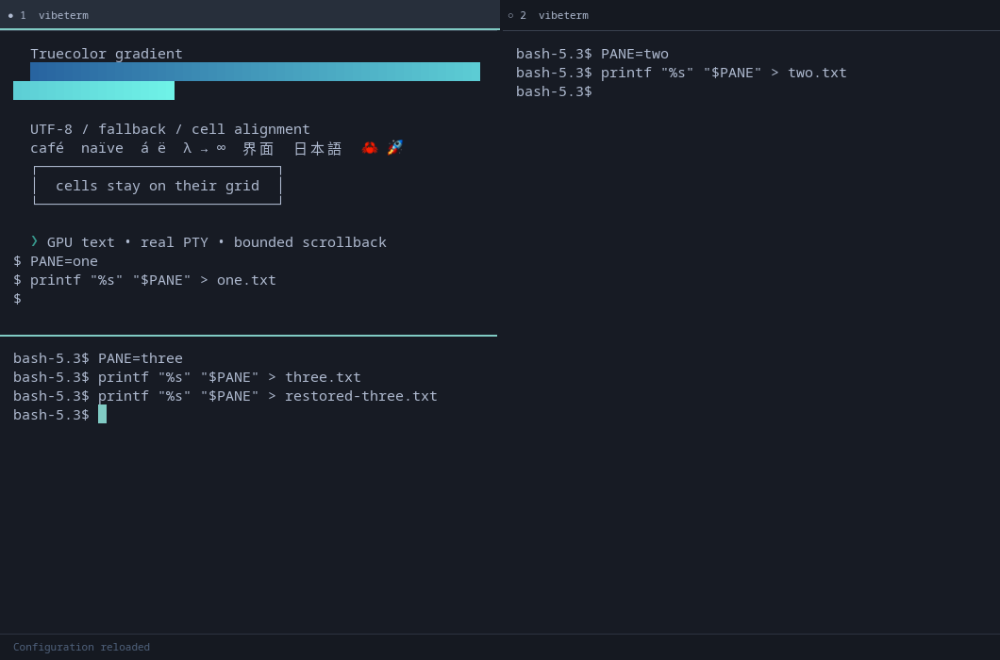

# Vibeterm

A native Linux terminal in Rust, with a real shell PTY and GPU text rendering.
Graphite surfaces, readable text, a quiet teal accent, and no continuous idle animation.

**Early multi-pane release; daily-driver acceptance is still in progress.** Tabs,
splits, history search, a command palette, and live configuration are implemented. Real Bash input, resize, Unicode/color rendering, and `less` were tested
on the desktop. The owner has confirmed selection/copy and middle-click paste work.
Broader clipboard/backend coverage, IME, and mixed-monitor scaling still need manual
acceptance. Workspace features have also passed the X11 desktop checks.



## Run

This checkout already has a release executable:

```sh
./target/release/vibeterm
./target/release/vibeterm -d ~/src
./target/release/vibeterm -e /bin/bash --noprofile --norc
./target/release/vibeterm --hold -e /usr/bin/printf '%s\n' 'arguments stay separate'
```

`-e` must be the final application option. Arguments are passed directly to the
program. Default shell: configured `shell`, then `$SHELL`, then `/bin/sh`. Default
directory: the launch directory. New tabs and splits launch the configured shell in the
focused shell's current directory (read from `/proc`, so no shell integration is needed),
falling back to the launch directory. They do not repeat a CLI `-e` command.
Shell exit closes its pane unless `--hold` is set; closing the last pane closes the window.

## Build

Rust **1.90.0** is the pinned toolchain/MSRV; `Cargo.lock` pins application dependencies.

```sh
cargo build --release --locked
cargo run --release --locked
```

CachyOS/Arch needs `base-devel`, `pkgconf`, Rust, `wayland`, `libxkbcommon`,
`fontconfig`, X11 libraries, `vulkan-icd-loader`, an appropriate graphics driver,
and an installed monospace font. `mesa` supplies the OpenGL fallback. Verified build
environment: Wayland 1.26, libxkbcommon 1.13.2, Fontconfig 2.18.3, Mesa/RADV 26.2.4.
AMD testing used `vulkan-radeon`. No system packages were installed or shell startup files edited.

The build session installed Rust only under `/tmp`; the binary needs no Rust
installation to run. To rebuild using that temporary compiler, see
[development instructions](docs/development.md).

Wayland is selected when available. Exercise X11/XWayland with:

```sh
env -u WAYLAND_DISPLAY WINIT_UNIX_BACKEND=x11 ./target/release/vibeterm
```

## Implemented

- Native winit window; wgpu Vulkan/OpenGL renderer; Glyphon glyph atlas.
- Alacritty terminal parser/state, real PTY, truecolor/256 colors, alternate screen,
  scroll regions, bounded scrollback, wide cells, and combining characters.
- Cosmic Text fallback/shaping, bold/italic, underline, inverse, dim, strikeout.
- Mouse selection, word/line selection, clipboard/primary selection, legacy mouse
  reporting, application cursor keys, bracketed paste, and focus reporting.
- IME preedit/commit plumbing, scale-aware layout, font zoom, validated TOML,
  automatic safe reload, status/error footer, explicit commands/working directories.
- Tabs and nested resizable splits, independent shells, mouse/keyboard focus switching.
- Background scrollback search, searchable command palette, configurable shortcuts.
- Bounded input queues/caches, coalesced wakeups, sleeping idle loop, child reaping.

See [compatibility](docs/compatibility.md) for what was actually verified. Shaping
is per terminal cell: cross-cell ligatures and full bidi layout are not promised.
There is no native accessibility tree or screen-reader support yet.

## Configure

Copy [config.example.toml](config.example.toml) to
`$XDG_CONFIG_HOME/vibeterm/config.toml` (normally `~/.config/vibeterm/config.toml`).
All settings are optional; no config is needed. Unknown keys/invalid values are
rejected. `--config PATH` chooses a file; `--check-config` validates it.
Invalid reloads keep the old settings and running shell, showing an error in the footer.
Changes reload automatically after a short debounce, including atomic file replacements.
Deleting the file restores defaults. Ctrl+Shift+R also reloads explicitly. Files are
limited to 64 KiB; existing shells keep running when the configured shell changes.

| Action | Shortcut |
| --- | --- |
| New tab | Ctrl+Shift+T |
| Split side by side / above and below | Ctrl+Shift+E / O |
| Close active pane | Ctrl+Shift+W |
| Next / previous tab | Ctrl+Tab / Ctrl+Shift+Tab |
| Next / previous pane | Ctrl+Shift+Right / Left |
| Search history | Ctrl+Shift+F |
| Command palette | Ctrl+Shift+P |
| Copy selection | Ctrl+Shift+C |
| Paste clipboard | Ctrl+Shift+V or Shift+Insert |
| Paste primary selection | Middle click |
| Select text / word / line | Drag / double click / triple click |
| Select while a TUI captures mouse | Hold Shift |
| Scroll history | Wheel or Shift+PageUp / PageDown |
| Oldest history / return to prompt | Shift+Home / End |
| Increase / decrease font | Ctrl++ / Ctrl+− |
| Reset font to configured size | Ctrl+0 |
| Reload configuration | Ctrl+Shift+R |
| Clear footer notice (also sends Escape) | Escape |

Click a pane or tab to focus it. Limits are eight tabs and 32 total panes; splits
need enough room for useful cells. Drag the gap between panes to resize a split.
Dragging a selection past a pane's top or bottom edge scrolls history. Zoom survives
configuration reloads as an offset from the configured `font_size`.
Search is literal and case-insensitive unless the query includes uppercase letters.
Enter finds the next match, Shift+Enter the previous match, and Escape closes search.
Output changes during a scan cancel its result; Enter retries. Queries are limited
to 256 UTF-8 bytes. Search selects one match at a time, which can be copied normally.

The palette filters commands as you type, shows unavailable actions, and supports
Up/Down, Enter, and Escape. Override shortcuts in `[keybindings]`; see the example
config. Empty strings disable bindings. Duplicate or invalid shortcuts reject the
entire reload. Palette/search consume their own navigation keys while open.

Releasing a selection updates primary selection; `copy_on_select` also updates the
regular clipboard. Paste is capped at 256 KiB and strips ESC to prevent escape from
the bracketed-paste envelope. Clipboard I/O runs off the UI thread. Wayland clipboard
availability depends on compositor data-control support or XWayland.

## Verify

```sh
cargo fmt --check
cargo clippy --workspace --all-targets --locked -- -D warnings
cargo test --workspace --locked
cargo build --examples --locked
python3 scripts/x11-smoke.py target/debug/vibeterm --workspace
# Optional pointer/clipboard checks, restoring pointer position afterward:
python3 scripts/x11-smoke.py target/debug/vibeterm --pointer
cargo run --release --locked --example replay -- 200000
python3 scripts/measure.py
```

PTY tests need real process/socket permissions. Desktop tests require display/GPU
access; the X11 script also uses `xprop`, ImageMagick, and libXtst. KWin prevented
synthetic pointer targeting in this session; manual mouse acceptance remains pending.
[Performance results](docs/performance.md) distinguish synthetic parsing and frame
submission from physical input latency. No competitor performance claim is made.

## Packaging and next steps

[packaging/PKGBUILD](packaging/PKGBUILD) builds a local source archive; instructions
are at its top. A desktop entry and original icon are included. Packaging has been
syntax/metadata checked only, not installed or published to AUR.

Next: complete manual input/backend acceptance, stress-test multi-pane workloads,
and polish selection, accessibility, and packaging. Shell-aware
navigation/workspaces follow in M3, external-process plugins in M4. AI is deferred.
See [status](docs/status.md) and [architecture](docs/architecture.md).
